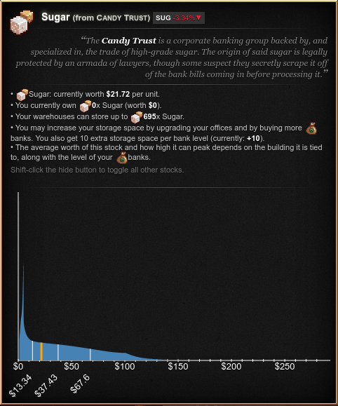
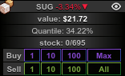
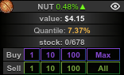

Insugar Trading
===============

**[Changelog](CHANGELOG.md)
| [Highlights](#highlights)
| [Using the mod](#using-the-mod)**

This is an add-on for [Cookie Clicker](https://orteil.dashnet.org/cookieclicker/)
that helps analyze the Stock Market minigame.

This add-on contains two parts:
the [dataset](#dataset), which is a histogram of the goods values in the stock market,
collected in a simulation of 1000 years of the market ups and downs;
and the [statistics display](#statistics),
which shows the histogram and the quantiles of the current goods values.


Dataset
=======

The grand goal of this addon is to display the [statistics](#statistics) described below.
Lacking a mathematical model for the probability density function,
I [wrote a tool](https://github.com/staticvariablejames/CookieClickerCppTools)
to simulate the stock market for a thousand years.
(If left unattended, the stock market ticks once every minute,
so simulating 525960000 ticks corresponds to a thousand years of stock market ups and downs.)
This produced a histogram,
which tracks how many times each good had a given value,
with a $0.10 precision.

Since the bank level and Krumblor's auras influences the good values,
I simulated for bank levels between 1 and 50
(which I believe to be sufficient for the vast majority of players)
and all four combinations of auras
(no auras, just "Reality Bending" active,
just "Supreme Intellect" active,
and both auras active).
So the dataset actually has 3600 histograms,
one for each bank level, aura combination, and good.

Highlights
----------

Averages and a five-number summary for banks level 1,
with no dragon auras.

| Good | Average | Min | 1st quartile | Median | 3rd quartile | Max |
|------|---------|-----|--------------|--------|--------------|-----|
| CRL | 32.05 | 1 | 6.37 | 21.94 | 49.2 | 247.5 |
| CHC | 35.7 | 1 | 8.06 | 26.66 | 55.15 | 259.8 |
| BTR | 39.62 | 1 | 10.35 | 31.79 | 61.26 | 263.9 |
| SUG | 43.88 | 1 | 13.34 | 37.43 | 67.6 | 283.3 |
| NUT | 48.38 | 1 | 16.98 | 43.42 | 73.98 | 287.1 |
| SLT | 53.08 | 1 | 21.17 | 49.67 | 80.34 | 291.3 |
| VNL | 58.02 | 1 | 25.9 | 56.17 | 86.67 | 297.3 |
| EGG | 63.16 | 1 | 31.07 | 62.81 | 92.88 | 301.2 |
| CNM | 68.51 | 1 | 36.62 | 69.6 | 98.87 | 325.6 |
| CRM | 74.12 | 1 | 42.61 | 76.51 | 104.32 | 336.3 |
| JAM | 79.99 | 1 | 48.85 | 83.54 | 109.99 | 337.4 |
| WCH | 86.21 | 1 | 55.48 | 90.69 | 116.25 | 332.9 |
| HNY | 92.78 | 1 | 62.41 | 97.96 | 123.13 | 352.6 |
| CKI | 99.7 | 1 | 69.62 | 105.05 | 130.67 | 377.3 |
| RCP | 107.02 | 1 | 77.16 | 112.25 | 138.76 | 385.7 |
| SBD | 114.72 | 1 | 85 | 119.84 | 147.37 | 384.6 |
| PBL | 122.69 | 1 | 93 | 127.82 | 156.25 | 400.6 |
| YOU | 130.96 | 1 | 101.17 | 136.29 | 165.41 | 392.5 |

For comparison,
the same data,
but for banks level 1 with both Supreme Intellect and Reality Bending active.

| Good | Average | Min | 1st quartile | Median | 3rd quartile | Max |
|------|---------|-----|--------------|--------|--------------|-----|
| CRL | 41.74 | 1 | 10.51 | 34.19 | 65.83 | 248 |
| CHC | 45.13 | 1 | 12.86 | 38.61 | 70.98 | 265.3 |
| BTR | 48.69 | 1 | 15.61 | 43.26 | 76.18 | 270 |
| SUG | 52.5 | 1 | 18.87 | 48.27 | 81.47 | 254 |
| NUT | 56.54 | 1 | 22.55 | 53.57 | 86.81 | 282.6 |
| SLT | 60.75 | 1 | 26.65 | 59.04 | 92.05 | 276 |
| VNL | 65.18 | 1 | 31.2 | 64.74 | 97.22 | 286.2 |
| EGG | 69.89 | 1 | 36.19 | 70.65 | 102.18 | 290.3 |
| CNM | 74.79 | 1 | 41.49 | 76.62 | 106.86 | 315.6 |
| CRM | 79.96 | 1 | 47.2 | 82.74 | 111.73 | 320.1 |
| JAM | 85.47 | 1 | 53.3 | 89.03 | 116.95 | 313.2 |
| WCH | 91.25 | 1 | 59.67 | 95.36 | 122.61 | 321.6 |
| HNY | 97.35 | 1 | 66.31 | 101.65 | 128.75 | 324 |
| CKI | 103.81 | 1 | 73.23 | 107.77 | 135.46 | 351.3 |
| RCP | 110.55 | 1 | 80.3 | 114.06 | 142.63 | 353.6 |
| SBD | 117.7 | 1 | 87.59 | 120.77 | 150.37 | 363.9 |
| PBL | 125.21 | 1 | 95.13 | 127.99 | 158.52 | 391.9 |
| YOU | 133.02 | 1 | 102.61 | 135.68 | 167.06 | 390.9 |


Statistics
==========

This add-on modifies the interface to add two bits of information to the stock market.



First,
it modifies the tooltip for the stock market goods
to display the histogram for that specific good.
The orange line is the current value of the good.
The three white lines are the 25%, 50%, and 75% percentiles,
so, for example, the first quartile for SUG is at $13.37.
The quantiles can be customized in the settings.



Second,
it adds a bar between the current good value and the amount owned of that good.
It displays the quantile of that good value,
compared to the dataset.
For example,
in the picture above,
SUG is worth $21.72 and its quantile is 34.22%;
this means that SUG was at or below $21.72 in 34.22% of the time during the simulation.



For goods you own which are in high quantiles
(which you might want to sell)
and goods you own which are in low quantiles
(which you might want to buy)
the color inside the bar will be colored orange,
in a spectrum
(further away from the median means more orange).
The threshold at which the good starts being highlighted can be changed in the settings.
By default,
it only highlights goods whose value are at or above their 75% quantile
(or, correspondingly, for goods you own,
at or below their 25% quantile).


Using the mod
=============

The best solution is adding
<https://staticvariablejames.github.io/InsugarTrading/dist/main.js>
to [Cookie Clicker Mod Manager](https://github.com/klattmose/CookieClickerModManager).

Alternatively,
run
```javascript
    Game.LoadMod('https://staticvariablejames.github.io/InsugarTrading/dist/main.js');
```
on your browser Javascript console,
or create a bookmarklet with the code
```javascript
    javascript:Game.LoadMod('https://staticvariablejames.github.io/InsugarTrading/dist/main.js');
```


Known Bugs/Limitations
======================

Only datasets for banks up to level 50 are available
(although I believe this should be enough for most players).

Currently,
the displayed quantiles are not immediately updated if the bank is leveled up,
or if the dragon auras are changed.
The quantiles are updated in the next market tick,
but the mod displays slightly incorrect information in the meanwhile.


License
=======

Insugar Trading is a Cookie Clicker add-on.
Copyright (C) 2020 Static Variable James

This program is free software: you can redistribute it and/or modify
it under the terms of the GNU General Public License as published by
the Free Software Foundation, either version 3 of the License, or
(at your option) any later version.

This program is distributed in the hope that it will be useful,
but WITHOUT ANY WARRANTY; without even the implied warranty of
MERCHANTABILITY or FITNESS FOR A PARTICULAR PURPOSE. See the
GNU General Public License for more details.

You should have received a copy of the GNU General Public License
along with this program. If not, see <https://www.gnu.org/licenses/>.
